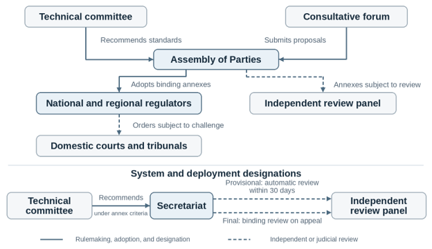
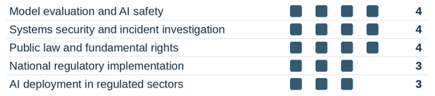
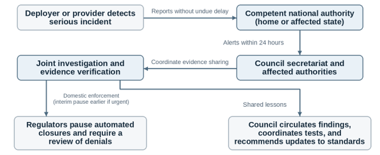

# A Global AI Governance Council

**A Proposal for Shared Rules and International Oversight**

[Read the policy paper (PDF)](A_Global_AI_Governance_Council.pdf)

This paper proposes a treaty-based council for AI systems that can cause serious harm across borders. The council would set common requirements for safety evaluations and incident reporting. National and regional regulators would enforce those requirements, and people harmed by a system would seek remedies through domestic processes.

The paper follows a hypothetical flood-assistance system used in several countries. When a shared software update causes eligible households to be denied aid, the case shows how regulators could alert one another, share evidence, and intervene in their own jurisdictions.

## What the proposal covers

- How the Assembly of Parties adopts binding technical annexes, how the secretariat designates covered systems, and how an independent panel reviews designations.
- How an 18-member technical committee would be appointed and draw on expertise in AI evaluation, incident investigation, fundamental rights, regulation, and deployment.
- How national authorities would issue cross-border incident alerts and verify evidence while protecting sensitive records.
- How a capacity and public-interest fund could support independent evaluation and locally led projects.

## Figures

### Figure 1. Who makes, enforces, and reviews the rules

### Figure 2. Illustrative allocation of technical committee seats

### Figure 3. Response to a cross-border AI incident

## Author and license

Murat Durmus developed the paper in collaboration with GPT-6.2 High and Gemini 4 Neon.

[CC0 1.0 Universal](LICENSE)
